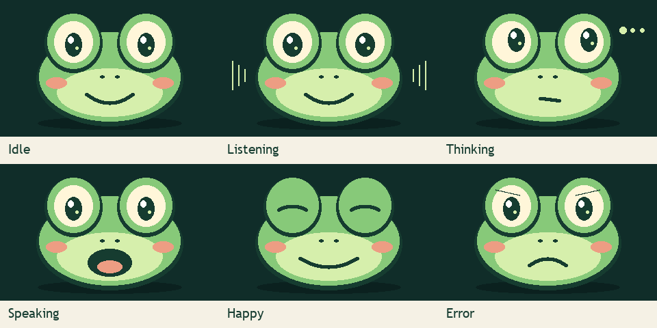
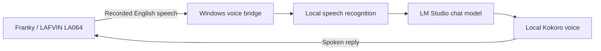

# DigitalRCS Local LLM Chatbot

**Meet Franky: a talking frog robot that uses your computer to listen, think, and speak.**

[Download Windows Setup](https://github.com/digitalrcs/DigitalRCS-Local-LLM-Chatbot/releases/download/v0.5.0-preview.1/DigitalRCS-Franky-0.5.0-preview.1-Setup.exe) · [Easy setup guide](docs/WINDOWS-INSTALLER.md) · [All guides](docs/README.md) · [Help with a problem](docs/TROUBLESHOOTING.md)

> **Preview release:** you can try it now, but testing on a completely fresh Windows PC is still outstanding. The installer is not digitally signed by DigitalRCS. It supports the **LAFVIN LA064 ESP32-S3 N16R8** kit; the guided USB step is only for that robot.

## English conversation, local processing

This independent community project grew from an English, local-LLM adaptation of [Wu Yu-chu's XiaoKe project for LAFVIN hardware](https://github.com/achir1015/esp32s3-lafvin-ai-chatbot). It is not an official LAFVIN release.

Franky's PC bridge brings together English speech recognition, an LM Studio chat model, and natural Kokoro speech. LM Studio is the default and may run on the same computer or another computer on your home network. OpenAI, OpenRouter free models, and Gemini are optional selections. No provider switches automatically. No paid cloud API account is required for local mode.

| Feature | Included in this preview |
| --- | --- |
| English speech recognition | Local faster-whisper, base.en |
| AI replies | Your selected LM Studio chat model |
| Natural male voices | 11 choices with previews; Liam is the default |
| Windows setup app | One installer with its own runtime, speech files, provider choices, and shortcuts |
| Volume and brightness commands | Spoken commands, web sliders, persistent levels in new firmware |
| Stop and service readiness | BOOT/web Stop, background speech loading, clear bridge readiness checks |
| Hands-free option | Say Hello Franky, pause by voice, resume with BOOT; experimental |
| Robot firmware | Newly written source, animated frog face, optional guided USB upload for the LA064 |
| Optional online providers | OpenAI API, OpenRouter free models, Gemini; bring your own key |

## Start here

You need a Windows 10/11 PC with an Intel or AMD 64-bit processor, the supported robot, a USB **data** cable, and home Wi-Fi that supports **2.4 GHz**. You also need Internet access for the download and, if you choose LM Studio, a chat model that fits your PC. A charging-only USB cable cannot update the robot.

1. **Download and open [Franky Setup.exe](https://github.com/digitalrcs/DigitalRCS-Local-LLM-Chatbot/releases/download/v0.5.0-preview.1/DigitalRCS-Franky-0.5.0-preview.1-Setup.exe).** Keep the suggested folder and open **Franky Setup** when installation finishes.
2. **Follow the seven steps in the window.** Choose where answers come from, check the voice, connect the robot, and try a question. The optional USB step installs the robot software for you.
3. **Next time, use Start Franky.** Keep the PC awake and your chosen answer service running.

The installer includes Python, speech tools, English listening models, and Franky's voices. **You do not need to type commands, install Arduino, edit code, or log in to Hugging Face.** The [step-by-step guide](docs/WINDOWS-INSTALLER.md) explains every page and button. If Windows asks for an administrator's password, ask the person who manages the PC.

Allow a few minutes for installation. The speech files take hundreds of megabytes, and a chat model can be several gigabytes, so slow downloads may take longer. Speech files are already included; LM Studio and its chat model are separate downloads.

### Which download do I choose?

| File on the release page | Who needs it? |
| --- | --- |
| **DigitalRCS-Franky-0.5.0-preview.1-Setup.exe** | Most Windows users. Start here. |
| **Windows.zip** | People who want the code or prefer [manual installation](docs/INSTALL.md). It does not contain the ready-to-run installer. |
| **Bundled-Sources.zip** | Developers who want the bundled components' source, notices, and firmware relink materials. |
| **SHA256SUMS.txt** or **.sha256** | Optional files for checking that a download is complete and unchanged. |
| GitHub's **Source code (zip/tar.gz)** | A copy of the repository for developers. It is not Setup.exe. |

### Where will the answers come from?

| Choice | What it means |
| --- | --- |
| **LM Studio on this PC** | Your computer writes the answers. No paid online AI account is needed. You download a chat model first. |
| **LM Studio on another home PC** | That computer writes the answers. Enter its address in setup and keep it running. |
| **OpenRouter, Gemini, or OpenAI** | An online service writes the answers. You need your own account and API key; limits and charges depend on the service. |

A **model** is the downloaded AI that writes answers. The **bridge** is Franky's PC helper: it connects the robot to the listening, answer, and voice tools. **Firmware** is the software stored inside the robot. Setup handles these parts step by step.

Already have an AI server? [Move the bridge and website to it](docs/WINDOWS-SERVER.md). The website comes with the bridge, so you do not need a separate web server.

## Meet the new Franky



Blinking, listening, thinking, speaking, happy, and error poses are drawn locally on the LCD. [Build and setup guide](docs/FIRMWARE.md) · [Source provenance](firmware/PROVENANCE.md)

## How it works



The robot records and plays audio; the computer does the heavy work. The prototype also applies commands such as “increase volume ten percent” and “set brightness to forty percent.” Those controls require the new Franky firmware; installing only the PC bridge does not change factory firmware.

## Privacy and requirements

Initial setup needs Internet access for the installer and your chosen chat service/model. The all-in-one installer includes the speech files. In default LM Studio mode, speech and chat processing can then run on your PC and home network. Optional online providers receive conversation text; see [provider choices, free tiers, and key setup](docs/PROVIDERS.md). The bridge does not intentionally save recordings or transcripts; LM Studio's own logging settings are separate. Keep the computer awake and the bridge running.

This preview is intended for **trusted home networks**. Its HTTP endpoints have no login and must not be forwarded to the Internet. See [security information](SECURITY.md).

The installer includes its own Python 3.13 runtime. Manual setup is tested with Python 3.11 and 3.13. LM Studio performance depends on the model and computer; choose a model LM Studio says fits your PC. Windows on ARM is not tested.

## Development

```powershell
$env:PYTHONPATH = "bridge"
.\.venv\Scripts\python.exe -m unittest discover -s tests -v
```

See [CONTRIBUTING.md](CONTRIBUTING.md) for development and packaging. See [CHANGELOG.md](CHANGELOG.md) for release scope.

## Credits and license

LAFVIN supplies the LA064 hardware. Wu Yu-chu (achir1015) created the downloaded XiaoKe adaptation that inspired this English/local project. DigitalRCS developed the included PC bridge, setup tools, and documentation. Whisper, faster-whisper, Kokoro, kokoro-onnx, and LM Studio make the local pipeline possible.

The included original code and frog artwork are offered under the [MIT license](LICENSE). Espressif codec files retain Apache 2.0 notices. That license does **not** apply to upstream firmware, fonts, model weights, LM Studio, or third-party dependencies. See [THIRD_PARTY_NOTICES.md](THIRD_PARTY_NOTICES.md).
