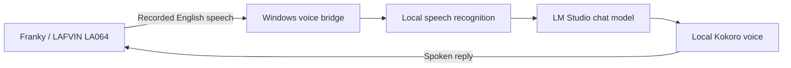

# DigitalRCS Local LLM Chatbot

**Meet Franky: an English-speaking chatbot companion powered by a local AI model.**

[Windows setup app](docs/WINDOWS-INSTALLER.md) · [Manual installation](docs/INSTALL.md) · [Voice software and downloads](docs/VOICE-SETUP.md) · [Move to a Windows AI server](docs/WINDOWS-SERVER.md) · [Troubleshooting](docs/TROUBLESHOOTING.md) · [How it works](docs/ARCHITECTURE.md) · [Credits](THIRD_PARTY_NOTICES.md)

> **Development preview.** Includes the PC bridge and newly written Franky firmware source for the LAFVIN LA064. The firmware has its own application code and frog artwork, with licensed Espressif codec drivers. Read the [firmware guide](docs/FIRMWARE.md) before building or flashing; the release does not bundle inherited XiaoKe firmware.

## English conversation, local processing

This independent community project grew from an English, local-LLM adaptation of [Wu Yu-chu's XiaoKe project for LAFVIN hardware](https://github.com/achir1015/esp32s3-lafvin-ai-chatbot). It is not an official LAFVIN release.

Franky's PC bridge brings together English speech recognition, an LM Studio chat model, and natural Kokoro speech. LM Studio is the default and may run on the same computer or another computer on your home network. OpenAI, OpenRouter free models, and Gemini are optional selections. No provider switches automatically. No paid cloud API account is required for local mode.

| Feature | Included in this preview |
| --- | --- |
| English speech recognition | Local faster-whisper, base.en |
| AI replies | Your selected LM Studio chat model |
| Natural male voices | 11 choices with previews; Liam is the default |
| Windows setup app | One installer with its own runtime, speech files, provider choices, and shortcuts |
| Volume and brightness commands | Spoken commands, web sliders, persistent levels in new firmware |
| Stop and service readiness | BOOT/web Stop, background speech loading, clear bridge readiness checks |
| Hands-free option | Say Hello Franky, pause by voice, resume with BOOT; experimental |
| Robot firmware | Newly written source, animated frog face, optional guided USB upload for the LA064 |
| Optional online providers | OpenAI API, OpenRouter free models, Gemini; bring your own key |

## Start here

1. Download **Setup.exe** from a release that provides the Windows installer. Run it on a Windows 10/11 x64 PC.
2. Follow **Franky Setup** to choose LM Studio or an online provider, check the voice, and connect your robot. Python and speech files are included; no terminal is needed.
3. Use **Start Franky** for everyday use. Keep the PC awake and your chosen answer service available.

The [Windows setup guide](docs/WINDOWS-INSTALLER.md) explains each choice. LM Studio and chat-model downloads depend on your connection and hardware. Windows may ask an administrator to approve runtime support or home-network access.

The **Windows ZIP** is still available for manual installation and development: extract it, install Python 3.13 and the [C++ speech runtime](docs/VOICE-SETUP.md), then run **START-HERE.cmd**. Follow [manual installation](docs/INSTALL.md) for that route.

You do not need to edit code for either route.

To run everything on your Windows AI server, follow [Move the bridge and website](docs/WINDOWS-SERVER.md). The website is included in the bridge, and **SET-BRIDGE-ADDRESS.cmd** records the LAN address shown in its connection settings. Franky's device settings page remains on the ESP32.

## Meet the new Franky


Blinking, listening, thinking, speaking, happy, and error poses are drawn locally on the LCD. [Build and setup guide](docs/FIRMWARE.md) · [Source provenance](firmware/PROVENANCE.md)

## How it works



The robot records and plays audio; the computer does the heavy work. The prototype also applies commands such as “increase volume ten percent” and “set brightness to forty percent.” Those controls require the new Franky firmware; installing only the PC bridge does not change factory firmware.

## Privacy and requirements

Initial setup needs Internet access for the installer and your chosen chat service/model. The all-in-one installer includes the speech files. In default LM Studio mode, speech and chat processing can then run on your PC and home network. Optional online providers receive conversation text; see [provider choices, free tiers, and key setup](docs/PROVIDERS.md). The bridge does not intentionally save recordings or transcripts; LM Studio's own logging settings are separate. Keep the computer awake and the bridge running.

This preview is intended for **trusted home networks**. Its HTTP endpoints have no login and must not be forwarded to the Internet. See [security information](SECURITY.md).

Windows x64 and Python 3.13 are the primary setup target. Python 3.11 is also used by the working prototype. LM Studio performance depends on your model and computer; this project does not prescribe one model or promise a minimum response speed.

## Development

```powershell
$env:PYTHONPATH = "bridge"
.\.venv\Scripts\python.exe -m unittest discover -s tests -v
```

See [CONTRIBUTING.md](CONTRIBUTING.md) for development and packaging. See [CHANGELOG.md](CHANGELOG.md) for release scope.

## Credits and license

LAFVIN supplies the LA064 hardware. Wu Yu-chu (achir1015) created the downloaded XiaoKe adaptation that inspired this English/local project. DigitalRCS developed the included PC bridge, setup tools, and documentation. Whisper, faster-whisper, Kokoro, kokoro-onnx, and LM Studio make the local pipeline possible.

The included original code and frog artwork are offered under the [MIT license](LICENSE). Espressif codec files retain Apache 2.0 notices. That license does **not** apply to upstream firmware, fonts, model weights, LM Studio, or third-party dependencies. See [THIRD_PARTY_NOTICES.md](THIRD_PARTY_NOTICES.md).
