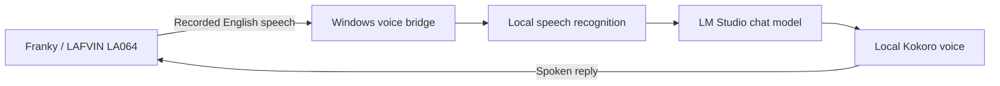

# DigitalRCS Local LLM Chatbot

**Meet Franky: an English-speaking chatbot companion powered by a local AI model.**

[Installation guide](docs/INSTALL.md) · [Troubleshooting](docs/TROUBLESHOOTING.md) · [How it works](docs/ARCHITECTURE.md) · [Credits](THIRD_PARTY_NOTICES.md)

> **Preview — PC voice bridge only.** The working prototype uses the LAFVIN LA064 ESP32-S3 chatbot kit. Modified robot firmware and flashable binaries are not included while redistribution permission for the upstream XiaoKe firmware is unresolved. This package can run and preview voices on your PC, but it cannot convert a factory LAFVIN robot by itself.

## English conversation, local processing

This independent community project grew from an English, local-LLM adaptation of [Wu Yu-chu's XiaoKe project for LAFVIN hardware](https://github.com/achir1015/esp32s3-lafvin-ai-chatbot). It is not an official LAFVIN release.

Franky's PC bridge brings together English speech recognition, an LM Studio chat model, and natural Kokoro speech. LM Studio may run on the same computer or another computer on your home network. No paid cloud API account is required for this local configuration.

| Feature | Included in this preview |
| --- | --- |
| English speech recognition | Local faster-whisper, base.en |
| AI replies | Your selected LM Studio chat model |
| Natural male voices | 11 American and British choices, with previews |
| Easy Windows launch | Double-click setup, start, and connection check |
| Volume and brightness commands | Parser/API included; requires compatible robot firmware |
| Robot firmware and USB flashing | **Not included** |
| ChatGPT / OpenAI cloud mode | Not configured or tested in this release |

## Start here

1. Read [what you need](docs/INSTALL.md#1-get-ready).
2. Download the Windows ZIP from [Releases](https://github.com/digitalrcs/DigitalRCS-Local-LLM-Chatbot/releases), then **Extract All**.
3. Install Python 3.13 (64-bit), prepare LM Studio, and double-click **START-HERE.cmd**.
4. Double-click **START-FRANKY.cmd** and open **http://localhost:8766** to try the voices.

The [step-by-step guide](docs/INSTALL.md) explains every stage, including what success looks like. You do not need to edit code.

## How the complete prototype works



The robot records and plays audio; the computer does the heavy work. The prototype also applies commands such as “increase volume ten percent” and “set brightness to forty percent.” Those controls require compatible firmware and are not implemented by the original factory firmware through this bridge alone.

## Privacy and requirements

Initial installation downloads software and models from the Internet. After those downloads, the configured local speech and chat processing can run on your PC and home network. The bridge does not intentionally save recordings or transcripts; LM Studio's own logging settings are separate. Keep the computers awake and the bridge window open.

This preview is intended for **trusted home networks**. Its HTTP endpoints have no login and must not be forwarded to the Internet. See [security information](SECURITY.md).

Windows x64 and Python 3.13 are the primary setup target. Python 3.11 is also used by the working prototype. LM Studio performance depends on your model and computer; this project does not prescribe one model or promise a minimum response speed.

## Development

```powershell
$env:PYTHONPATH = "bridge"
.\.venv\Scripts\python.exe -m unittest discover -s tests -v
```

See [CONTRIBUTING.md](CONTRIBUTING.md) for development and packaging. See [CHANGELOG.md](CHANGELOG.md) for release scope.

## Credits and license

LAFVIN supplies the LA064 hardware. Wu Yu-chu (achir1015) created the downloaded XiaoKe adaptation that inspired this English/local project. DigitalRCS developed the included PC bridge, setup tools, and documentation. Whisper, faster-whisper, Kokoro, kokoro-onnx, and LM Studio make the local pipeline possible.

The included original code is offered under the [MIT license](LICENSE). That license does **not** apply to upstream firmware, fonts, model weights, LM Studio, or third-party dependencies. See [THIRD_PARTY_NOTICES.md](THIRD_PARTY_NOTICES.md).
