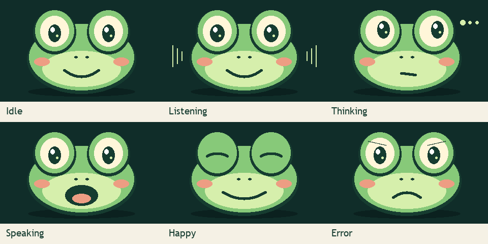

# Franky's robot firmware — development preview

This is newly written firmware for the **LAFVIN LA064 ESP32-S3 N16R8 kit**. It uses the official hardware pin mapping and licensed Espressif codec drivers. It is a separate implementation from the earlier XiaoKe-based prototype.



## Easiest way: use the Windows setup app

Follow the [Windows installer guide](WINDOWS-INSTALLER.md) to install the PC software. Its optional **Robot** step includes ready-to-install **0.4.0-dev** firmware for the **LAFVIN LA064 ESP32-S3 N16R8**. You do not need Arduino or a compiler for this route. Skip the robot update if compatible Franky firmware is already working.

1. Connect the kit with a USB data cable and close any serial monitor.
2. Open **Franky Setup → Robot**, choose **Refresh USB ports**, and select the kit's port. If unsure, compare the list with the robot unplugged and plugged in.
3. Select the checkbox confirming the supported kit, then choose **Install robot firmware**.
4. Keep the cable connected until the update finishes and Franky restarts. Continue with [Connect Franky](#connect-franky) below.

The installer saves a private backup of the settings region before writing and does not erase all flash. This is not a full backup of the old firmware. Existing Franky settings are preserved; importing factory firmware settings is not guaranteed. If no port appears, choose **USB driver help**.

## What it implements

- An original frog face: blinking, listening, thinking, speaking, happy, setup, and error expressions.
- English setup and status messages; no downloaded fonts or character images.
- Hold **BOOT** to record up to ten seconds; release to send. The web page can start a six-second recording.
- Local English recognition, LM Studio replies, and Kokoro speech through the PC bridge. New bridge installations default to **Liam**.
- Spoken volume/brightness commands, web sliders, and persistent settings.
- A setup hotspot and recovery path, plus an optional reuse of Wi-Fi credentials already stored by the ESP32 Wi-Fi driver.
- A short previous-turn chat context, bounded recording/reply buffers, and hardware controls accepted only through explicit parser metadata.

While audio plays, the mouth opens to one of four sizes based on the audio's loudness. This is amplitude-driven animation, not phoneme lip-sync. Expressions indicate device activity, not an assessment of the user's emotions. Optional hands-free mode uses local bridge recognition for “Hello Franky”; see [hands-free and pause](HANDS-FREE.md).

## Supported hardware and existing settings

The firmware remains a development preview. A successful upload or compile does not prove the microphone, speaker, or LCD works on every board revision; try a short question after setup. Full flash backups can contain Wi-Fi passwords and must never be posted to GitHub.

Use a USB **data** cable. Do not select a different ESP32 board or erase all flash as a troubleshooting shortcut. The build targets 16 MB flash and 8 MB OPI PSRAM. It is not intended for ESP32-C3/C6, ESP32-S2, or smaller-memory boards.

## Manual option: build on Windows

Use this section if you want to build or change the source. It is not required for the Windows installer's bundled firmware.

1. Install [Arduino IDE 2](https://www.arduino.cc/en/software). The scripts use the Arduino CLI included with its Windows installation. A standalone `arduino-cli` on PATH also works.
2. Download or clone this repository and extract it to a normal folder.
3. Open PowerShell in that folder. Run:

   ```powershell
   powershell -NoProfile -ExecutionPolicy Bypass -File .\scripts\build-firmware.ps1 -Install
   ```

4. The first run downloads the pinned ESP32 board package and display/JSON libraries. Later builds can omit `-Install`.
5. Wait for **Firmware built**. A first build may take 10–20 minutes on some PCs. Files appear in `build-firmware`. Building alone does not change your robot.

The current build uses Arduino-ESP32 **4.0.0-alpha1**, explicitly pinned to the development environment. Treat it as a preview, not a stable-core compatibility claim. The script limits parallel compilation to four jobs to reduce memory pressure.

## Manual option: flash your own build

Close any serial monitor first. Find the kit's COM port in Arduino IDE or Windows Device Manager. Replace `COM9` below with **your** kit's port:

```powershell
powershell -NoProfile -ExecutionPolicy Bypass -File .\scripts\flash-firmware.ps1 -Port COM9
```

The script uploads at 115200 baud for broad USB reliability; allow a couple of minutes. This replaces the application, bootloader, and partition information using the pinned board definition. It does not request a full-flash erase. The new application uses its own `franky2` settings namespace; the old application's settings are not deleted or imported. The ESP32 platform's saved Wi-Fi connection may be reusable, but that is not guaranteed.

## Connect Franky

1. In **Franky Setup → Try it**, choose **Start bridge**, then **Check readiness**. For a source ZIP installation, use the [manual installation guide](INSTALL.md).
2. If Franky has no usable saved connection, wait about 20 seconds for setup mode.
3. On a phone, join **DigitalRCS**, password **11181118**, then open **http://192.168.4.1**. Accept the phone's option to stay connected without Internet if necessary.
4. Enter your home **2.4 GHz** Wi-Fi name/password and the **Robot / phone bridge address** from the setup app's **Connect** step, such as `http://YOUR-PC-ADDRESS:8766`. Port 1234 is for LM Studio; Franky needs port 8766.
5. Choose **Save connection & restart**. Rejoin your home Wi-Fi and use the device address shown on Franky's LCD.
6. Choose Liam or another voice on the linked voice picker. Keep the bridge PC awake and your chosen answer service available; local answers also need LM Studio and its selected model running.

For recovery, hold **Page Up** for three seconds while idle to reopen the setup hotspot. **Page Down** plays a quiet speaker-test tone. Do not hold BOOT while switching the power on; that selects ESP32 download mode instead of starting Franky.

## Try the controls

Hold BOOT and say “increase volume ten percent,” then release. Franky should confirm the resulting value. “Set brightness to forty percent” sets an absolute level. Volume is limited to 0–100; brightness is limited to 10–100 so the screen remains visible. Percent changes mean percentage points.

The device page offers the same settings through **Save sound & display**. Settings are available during passive wake listening but locked during an active conversation; use **Stop current reply** first if needed. Saved levels survive a restart. A random per-boot request token protects browser writes against unrelated websites; it is **not** a login or protection from other users on your LAN.

## Development checks

The control logic can be tested without a board using a C++17 compiler:

```sh
g++ -std=c++17 -Wall -Wextra -Werror tests/control_logic_test.cpp -o control-test
./control-test
```

Regenerate artwork with `python scripts/generate_frog.py` and embed setup-page changes with `python scripts/embed_setup.py`. These generators require only Python's standard library. Commit the generated files alongside the source changes.

See [firmware provenance](../firmware/PROVENANCE.md) for source origins, versions, hashes, and license boundaries.
